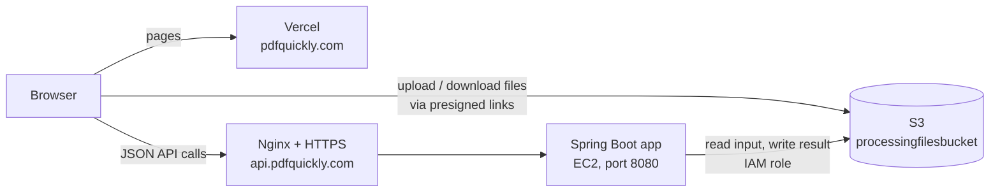

# Running pdfquickly.com

How the live site is put together, how to deploy it, where every setting lives,
and what to do when something breaks. For local development, SEO rules and the
code layout, see the [README](../README.md). The backend's own deploy details
are in `DEPLOY.md` in the File-Converter-backed repo.

Last updated 2026-10-31.

## How it fits together



A conversion takes four steps, and the files never pass through the API server:

1. The browser asks the API for upload links (`POST /api/v1/.../upload-urls`).
2. It uploads each file **straight to S3** with those links.
3. It calls `/start`. The app reads the files from S3, converts them, writes the
   result to S3, and returns a download link. The request stays open while it
   converts.
4. The browser downloads the result **straight from S3**.

Because of steps 2 and 4, **S3 has its own CORS list** separate from the API's.
A new website address has to be added to both.

## Where everything lives

| Part | Where | Code | How it deploys |
|---|---|---|---|
| Website | Vercel project `pdfquickly-web` | `PavanKumarHosmani/pdfquickly-web` | Push to `main` → Vercel builds and publishes |
| API | EC2, Amazon Linux 2023, ap-south-1 | `PavanKumarHosmani/File-Converter-backed` | Merge to `main` → GitHub Actions "Deploy to EC2" |
| HTTPS for the API | Nginx + Certbot (Let's Encrypt) on the same EC2 | `setup-api-domain.yml` in the backend repo | Run once per hostname; renews itself |
| Files | S3 bucket `processingfilesbucket`, ap-south-1 | — | AWS console |
| S3 access | IAM role `img2pdf-ec2-role` attached to the instance | — | AWS console |

On the server, the app runs as the systemd service `img2pdf`
(`/home/ec2-user/img2pdf-0.1.0.jar`). You shouldn't need to log in: deploys,
diagnostics and HTTPS setup all run from GitHub Actions.

## Domains and DNS

| Name | Record | Points to | Notes |
|---|---|---|---|
| `pdfquickly.com` | as Vercel shows | Vercel | **Main address.** Vercel: *Connect to Production* |
| `www.pdfquickly.com` | as Vercel shows | Vercel | Vercel: *Redirect to pdfquickly.com, 308* |
| `api.pdfquickly.com` | A | EC2 public IPv4 | Should be an Elastic IP, see [Open items](#open-items) |
| `pdfquickly.com` | TXT | `google-site-verification=…` | Proves ownership to Google. Leave it in place |

> **Never set Vercel to redirect `pdfquickly.com` → `www`.** The site's own code
> (`next.config.ts`) redirects `www` → `pdfquickly.com`, so the two loop and the
> browser shows *"redirected you too many times"*.

The API used to be `api.jpgstopdf.com`. That domain expired in October 2026.
jpgstopdf.com and pdfsmerger.com are no longer used.

## Settings

### Website (Vercel → Settings → Environment Variables)

| Name | Value | Notes |
|---|---|---|
| `NEXT_PUBLIC_API_BASE_URL` | `https://api.pdfquickly.com/api/v1` | Built into the pages. Must **not** be marked *Sensitive*; Vercel refuses that for `NEXT_PUBLIC_` names |
| `GOOGLE_SITE_VERIFICATION` | — | Not needed; Google is verified by DNS |
| `BING_SITE_VERIFICATION` | — | Not needed; Bing was imported from Google |
| `ADMOB_PUBLISHER_ID` | `pub-…` (AdMob → Settings → Account information) | Serves https://pdfquickly.com/app-ads.txt for the Android app's ads. Returns 404 until set |

None of these are secrets. A change only takes effect after **Redeploy** (on
the latest deployment; redeploying an older one rebuilds old code).

### API (GitHub → File-Converter-backed → Settings → Secrets and variables → Actions)

| Name | Kind | Value |
|---|---|---|
| `EC2_HOST` | secret | The instance's public IP or DNS name |
| `EC2_USER` | secret | `ec2-user` |
| `EC2_SSH_KEY` | secret | The instance's private key, including the BEGIN/END lines |
| `API_BASE_URL` | secret | `https://api.pdfquickly.com` (no `/api/v1`) |
| `AWS_REGION` | variable, optional | Defaults to `ap-south-1` |
| `AWS_BUCKET_NAME` | variable, optional | Defaults to `processingfilesbucket` |

There are **no AWS access keys** anywhere. The app gets short-lived credentials
from the instance's IAM role, and AWS rotates them. Don't add keys back: the AWS
SDK prefers keys over the role, so a stale key silently wins and breaks uploads
the day it is deleted. Deploys fail on purpose if a key is found.

Allowed website addresses for the API are `app.cors.allowed-origins` in the
backend's `src/main/resources/application.properties`.

### IAM role `img2pdf-ec2-role`

Attached to the instance (EC2 → instance → Security tab → IAM Role). Its policy
allows only this bucket:

```json
{
  "Version": "2012-10-17",
  "Statement": [
    { "Effect": "Allow",
      "Action": ["s3:GetObject", "s3:PutObject", "s3:DeleteObject", "s3:AbortMultipartUpload"],
      "Resource": "arn:aws:s3:::processingfilesbucket/*" },
    { "Effect": "Allow",
      "Action": "s3:ListBucket",
      "Resource": "arn:aws:s3:::processingfilesbucket" }
  ]
}
```

### S3 bucket CORS

S3 → `processingfilesbucket` → **Permissions** → scroll to the **last** section,
*Cross-origin resource sharing (CORS)*. (Not *Bucket policy*: pasting this
there fails with "Data Type Mismatch… expected Object".)

```json
[
  {
    "AllowedOrigins": ["https://pdfquickly.com", "https://www.pdfquickly.com", "http://localhost:3000"],
    "AllowedMethods": ["GET", "PUT", "HEAD"],
    "AllowedHeaders": ["*"],
    "ExposeHeaders": ["ETag"],
    "MaxAgeSeconds": 3000
  }
]
```

The live configuration may still list pdfsmerger.com and the old Vercel
addresses. They are harmless and can be removed.

## Deploying

### Website

Push to `main`. Vercel builds it in about a minute. After a production deploy,
`.github/workflows/indexnow.yml` tells Bing about the pages.

### API

Merge a pull request into `main` of File-Converter-backed. **Deploy to EC2** then:

1. builds the JAR and runs the tests (a failing test stops the deploy)
2. copies the JAR to the server and writes the service settings (`/etc/img2pdf.env`)
3. restarts the service
4. **verifies** the new build on the server itself through `/api/v1/health`:
   `maxDimension` must be 2600, `webpAvailable` true, and `awsKeysInEnvironment` false
5. checks the public URL, which only **warns** if it fails (DNS, Nginx or the secret, not the app)
6. if step 4 fails: prints the service log and IAM role status
   (*Show why the service failed*), then restores the previous JAR

To redeploy without a code change: Actions → Deploy to EC2 → **Run workflow**.

### Changing the API's hostname

1. Add an A record for the new name pointing at the instance's IP.
2. Check the instance's security group allows inbound **80** and **443**.
3. Actions → **Set up API domain** → Run workflow, with the name. It adds the
   Nginx site and gets the certificate, and stops with the right IP if DNS is wrong.
4. Set `API_BASE_URL` to `https://<name>` and `NEXT_PUBLIC_API_BASE_URL` in
   Vercel to `https://<name>/api/v1`, then redeploy the website.

### Adding another website that uses the API

Add its address to **both** `app.cors.allowed-origins` (backend, then deploy)
and the S3 bucket CORS `AllowedOrigins`.

## Checking that it works

```bash
curl https://api.pdfquickly.com/api/v1/health
```

| Field | Healthy value | If not |
|---|---|---|
| `status` | `ok` | No answer at all → see troubleshooting |
| `maxDimension` | `2600` | `1800` means a very old build is running |
| `webpAvailable` | `true` | WebP to PDF will fail |
| `awsKeysInEnvironment` | `false` | An AWS key is in the service settings; remove it |
| `region` | `ap-south-1` | Wrong region or bucket settings |

Then try one real conversion on pdfquickly.com. That covers the API, S3 CORS
and the IAM role permissions together.

## Troubleshooting

Every one of these has happened. In the browser, open DevTools (F12) →
**Console** to see the real error behind the site's message.

| What you see | Cause | Fix |
|---|---|---|
| *pdfquickly.com redirected you too many times* | Vercel redirects to `www` while the code redirects back | Vercel → Domains: `pdfquickly.com` → Production, `www` → redirect to `pdfquickly.com` |
| *Couldn't reach the server* + console `ERR_NAME_NOT_RESOLVED` | The site calls an API host that doesn't exist (e.g. the expired `api.jpgstopdf.com`) | Fix `NEXT_PUBLIC_API_BASE_URL` in Vercel, then Redeploy |
| *Couldn't reach the server* + console *blocked by CORS policy* on `processingfilesbucket.s3…` | The website's address isn't in the **S3** CORS list | Add it, see [S3 bucket CORS](#s3-bucket-cors) |
| Console *blocked by CORS policy* on `api.pdfquickly.com` | The address isn't in the **backend's** CORS list | Add it to `app.cors.allowed-origins` and deploy |
| Console certificate error / *certificate has expired* | The certificate doesn't cover the hostname | Run **Set up API domain** for that name |
| Deploy fails at *Add EC2 to known_hosts* or *Copy JAR* | GitHub can't SSH to the server | Security group: allow SSH (22). Check `EC2_HOST` is the current IP |
| Deploy fails at *Verify the new build* | The app didn't start | Read the *Show why the service failed* step. `404` under IAM role = attach `img2pdf-ec2-role` |
| Uploads fail with S3 **403** although CORS is right | The IAM role's policy is missing or wrong | IAM → Roles → `img2pdf-ec2-role` → Permissions; compare with the policy above |
| Vercel: *public framework prefix cannot use visibility: secret* | The variable was marked *Sensitive* | Turn *Sensitive* off |
| A Vercel variable change has no effect | No new build, or an old deployment was redeployed | Redeploy the **latest** deployment |

## Search engines

| | Status (2026-10-31) |
|---|---|
| Sitemap | `https://pdfquickly.com/sitemap.xml`, 22 pages |
| robots.txt | Allows everything; links the sitemap |
| Google Search Console | *Domain* property for `pdfquickly.com`, verified by a DNS TXT record; submit `sitemap.xml` under Sitemaps |
| Bing Webmaster Tools | *Import from Google Search Console* (after Google is verified); check the sitemap is listed |
| IndexNow | All 22 pages submitted (202 Accepted). Key file `public/ad0747afef834b76ab11f31fe71da6f0.txt` — don't delete it |

Expect indexing to take 1–4 weeks for a new domain. *Discovered – currently not
indexed* in Search Console is normal at first. After adding or changing pages,
run `npm run indexnow` (or `npm run indexnow -- /merge-pdf` for one page);
Google picks changes up from the sitemap.

## Open items

- [ ] **S3 lifecycle rule.** The privacy page promises files are deleted within
      24 hours, but the backend never deletes results. Bucket → Management →
      Create lifecycle rule → all objects → expire current versions after 1 day,
      and delete incomplete multipart uploads after 1 day.
- [ ] **Elastic IP.** Without one, stopping the instance changes its IP and
      `api.pdfquickly.com` stops working. EC2 → Elastic IPs → allocate,
      associate with the instance, then update the `api` A record and `EC2_HOST`.
- [ ] **Contact email.** The site and both privacy policies show `hello@pdfquickly.com`
      (`contactEmail` in `src/lib/site.ts`). Forward it to your inbox for free with ImprovMX:
      add the domain at improvmx.com, then in DNS add `MX @ mx1.improvmx.com` (priority 10),
      `MX @ mx2.improvmx.com` (priority 20) and `TXT @ v=spf1 include:spf.improvmx.com ~all`.
      Send a test email once ImprovMX shows the domain as active.
- [ ] **app-ads.txt.** Set `ADMOB_PUBLISHER_ID` in Vercel and redeploy; check
      https://pdfquickly.com/app-ads.txt shows `google.com, pub-…, DIRECT, f08c47fec0942fa0`.
- [ ] **Search engines.** Finish Google Search Console and Bing Webmaster Tools
      as in [Search engines](#search-engines), then tick the rows off there.
- [ ] **Optional tidy-up.** Remove pdfsmerger.com and jpgstopdf.com addresses
      from the backend CORS list and the S3 CORS list.
